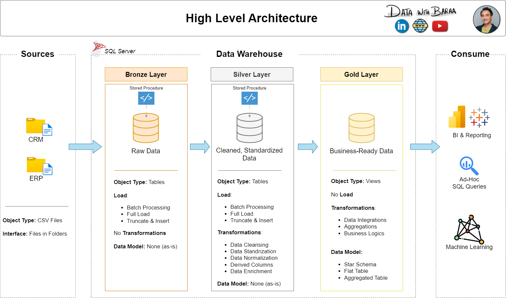
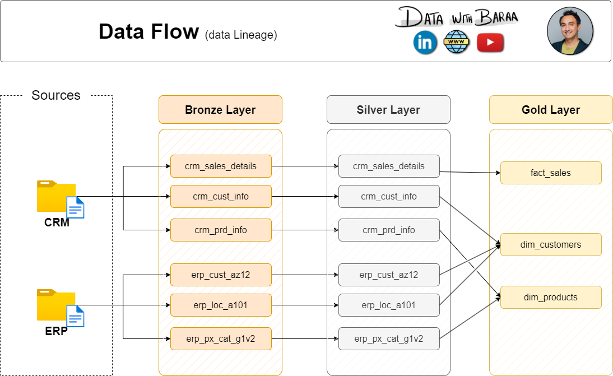
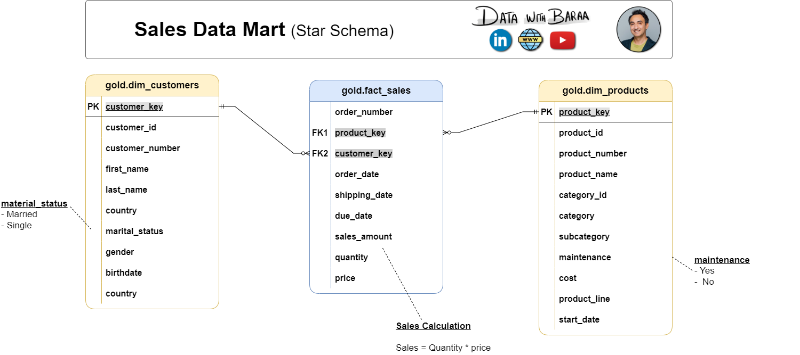

<div align="center">

# SQL Server Data Warehouse

**An end-to-end data warehousing project built with SQL Server and Medallion Architecture**





</div>

---

Developed a SQL Server Data Warehouse to integrate sales data from CRM and ERP systems.

Implemented Bronze, Silver, and Gold layers for data ingestion, cleansing, transformation, and integration.

Designed a Gold-layer Star Schema and added data-quality checks and project documentation.

## Project Goals

- Build a SQL Server data warehouse to integrate CRM and ERP data.
- Implement Bronze, Silver, and Gold layers for data ingestion, cleansing, and transformation.
- Develop a Gold-layer sales data mart using a Star Schema.
- Ensure data accuracy through SQL-based quality checks.
- Document the architecture, ETL workflow, data model, and data definitions.


## Technology Stack

| Area | Technology / Approach |
|---|---|
| Database | Microsoft SQL Server |
| Query language | T-SQL |
| Data ingestion | CSV source files and SQL loading procedures |
| Architecture | Medallion Architecture (Bronze, Silver, Gold) |
| Data modelling | Dimensional modelling / Star Schema |
| Processing | Stored procedures and SQL transformations |
| Version control | Git and GitHub |

## Architecture

The warehouse follows a three-layer Medallion Architecture.


### 1. Bronze Layer — Raw Data

The Bronze layer stores source data in its original structure.

- Receives CSV data from CRM and ERP.
- Stores raw records in source-oriented tables.
- Uses a full-load approach with truncate-and-insert processing, as documented for this project.
- Keeps transformations out of the raw ingestion layer.

### 2. Silver Layer — Cleaned and Standardized Data

The Silver layer prepares source data for integration and analysis.

- Cleans and standardizes source data.
- Applies normalization and derived-column logic where required.
- Enriches and prepares data for downstream modelling.
- Uses SQL stored procedures to load the layer.

### 3. Gold Layer — Business-Ready Data

The Gold layer presents integrated data in an analytical structure.

- Combines relevant CRM and ERP information.
- Organizes data into customer and product dimensions and a sales fact table.
- Uses a star-schema model for analytical querying.
- Provides business-oriented data for reporting and analysis.

## Source Systems

The project uses six CSV datasets across two source systems.

| Source system | Dataset file | Description |
|---|---|---|
| CRM | `cust_info.csv` | Customer information |
| CRM | `prd_info.csv` | Product information |
| CRM | `sales_details.csv` | Sales transaction details |
| ERP | `CUST_AZ12.csv` | Additional customer information |
| ERP | `LOC_A101.csv` | Customer location information |
| ERP | `PX_CAT_G1V2.csv` | Product category information |

The source-system relationship and integration documentation is available in [`docs/data_integration.png`](docs/data_integration.png).

## Data Flow

The datasets move from their source files into corresponding Bronze tables, then into Silver tables for cleaning and standardization. The prepared data is integrated into the Gold data mart.



The diagram shows the source-to-target lineage for the CRM and ERP entities and their movement across the three warehouse layers.

## Gold Layer Data Model

The Gold layer contains one fact table and two dimension tables.

<p align="center">
  
</p>

| Table | Type | Purpose |
|---|---|---|
| `gold.fact_sales` | Fact | Stores sales transactions and measures, with keys linking to customer and product dimensions. |
| `gold.dim_customers` | Dimension | Stores customer attributes, including demographic and geographic information. |
| `gold.dim_products` | Dimension | Stores product attributes and product classification details. |

### Relationships

- `fact_sales.customer_key` links to `dim_customers.customer_key`.
- `fact_sales.product_key` links to `dim_products.product_key`.

The fact table includes order dates, shipping and due dates, sales amount, quantity, and price. The dimensions provide descriptive context for analysing sales.

For column-level definitions, see [`docs/data_catalog.md`](docs/data_catalog.md).

## ETL Approach

The project separates ETL responsibilities across the warehouse layers:

| Layer | Load / processing approach | Main responsibility |
|---|---|---|
| Bronze | Full load; truncate and insert | Ingest raw source data |
| Silver | Full load; truncate and insert | Clean, standardize, and prepare data |
| Gold | Business-oriented presentation | Integrate data into analytical structures |

The ETL overview diagram is available in [`docs/ETL.png`](docs/ETL.png).

## Data Quality

SQL validation scripts are provided for both the Silver and Gold layers:

- [`tests/quality_checks_silver.sql`](tests/quality_checks_silver.sql)
- [`tests/quality_checks_gold.sql`](tests/quality_checks_gold.sql)

These scripts are intended to support validation of the prepared and analytical data. Run the checks after loading the corresponding layer.

## Repository Structure

```text
sql-data-warehouse-project/
│
├── datasets/
│   ├── source_crm/
│   │   ├── cust_info.csv
│   │   ├── prd_info.csv
│   │   └── sales_details.csv
│   │
│   └── source_erp/
│       ├── CUST_AZ12.csv
│       ├── LOC_A101.csv
│       └── PX_CAT_G1V2.csv
│
├── docs/
│   ├── ETL.png
│   ├── data_architecture.png
│   ├── data_catalog.md
│   ├── data_flow.png
│   ├── data_integration.png
│   ├── data_layers.pdf
│   ├── data_model.png
│   ├── naming_conventions.md
│   └── readme-assets/
│       └── architecture.svg
│
├── scripts/
│   ├── init_database.sql
│   ├── bronze/
│   │   ├── ddl_bronze.sql
│   │   └── proc_load_bronze.sql
│   ├── silver/
│   │   ├── ddl_silver.sql
│   │   └── proc_load_silver.sql
│   └── gold/
│       └── ddl_gold.sql
│
├── tests/
│   ├── quality_checks_gold.sql
│   └── quality_checks_silver.sql
│
├── LICENSE
└── README.md
```

## Getting Started

### Prerequisites

- Microsoft SQL Server.
- SQL Server Management Studio (SSMS) or another SQL Server-compatible client.
- Git, if you want to clone the repository.

### 1. Clone the repository

```bash
git clone https://github.com/AtharvBhavsar22/sql-data-warehouse-project.git
cd sql-data-warehouse-project
```

### 2. Review the project files

Before executing the scripts, review the SQL files and the source-data locations. In particular, check the file paths used by the Bronze loading procedure and update them to match the location of the cloned repository on your machine.

### 3. Execute the SQL scripts in sequence

Use SQL Server Management Studio to execute the scripts in the following order:

1. `scripts/init_database.sql`
2. `scripts/bronze/ddl_bronze.sql`
3. `scripts/silver/ddl_silver.sql`
4. `scripts/gold/ddl_gold.sql`
5. `scripts/bronze/proc_load_bronze.sql`
6. `scripts/silver/proc_load_silver.sql`

After creating the database objects and procedures, execute the Bronze and Silver loading procedures according to their definitions in the SQL files. Then run the data-quality scripts:

7. `tests/quality_checks_silver.sql`
8. `tests/quality_checks_gold.sql`

**Note:** The exact execution commands and any required SQL Server permissions depend on the implementation in the scripts. Review the procedure definitions before running them. The repository documentation should be treated as the guide to the intended layer responsibilities.

## Documentation

| Document | Description |
|---|---|
| [High-Level Architecture](docs/data_architecture.png) | Overview of the source systems and warehouse layers |
| [Data Flow](docs/data_flow.png) | Source-to-target lineage across the layers |
| [Data Integration](docs/data_integration.png) | Relationships between CRM and ERP entities |
| [Gold Data Model](docs/data_model.png) | Sales star schema |
| [ETL Methods](docs/ETL.png) | ETL concepts and processing methods |
| [Data Layers](docs/data_layers.pdf) | Responsibilities and characteristics of Bronze, Silver, and Gold |
| [Data Catalog](docs/data_catalog.md) | Gold-layer table and column definitions |
| [Naming Conventions](docs/naming_conventions.md) | Naming standards for warehouse objects |

